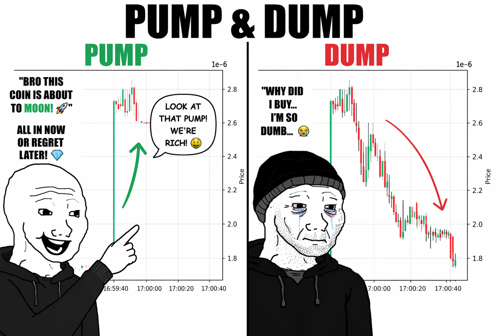
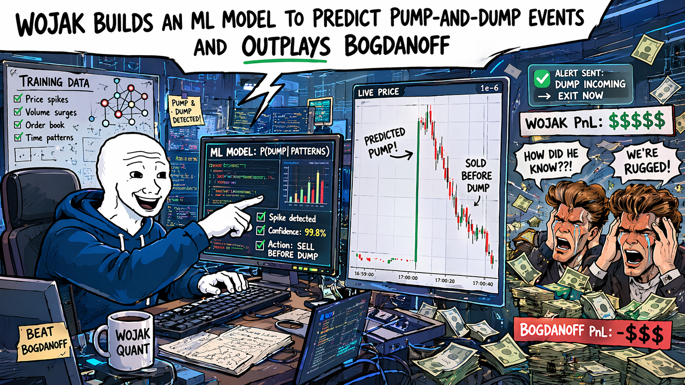

# Confidence-Aware Pump-and-Dump Target Prediction

Confidence-sensitive learning and portfolio allocation for Binance P&D events.

<p align="center">
  
</p>

## What is a pump-and-dump?

A pump-and-dump (P&D) is a coordinated market-manipulation scheme. Organizers accumulate a cheap, thinly traded asset in advance, then a Telegram/Discord channel broadcasts a synchronized "buy now" signal to thousands of followers at a pre-announced timestamp. The sudden demand spike (the **pump**) inflates the price within seconds. Insiders sell into that retail bid, collapsing the price over the next few minutes (the **dump**) and leaving late buyers with losses. In crypto these schemes target low-cap Binance tokens because order books are shallow enough for a few thousand USDT of coordinated flow to move the mid-price by 5% or more in under a minute.

The image above shows a real test-set event from our dataset: a 4% jump at the announcement (left panel) followed by a 30% drawdown within 40 seconds (right panel).

The detection task in this repository is the **target-prediction** variant: given an announcement is about to happen, rank all eligible BTC-quoted pairs on Binance by their probability of being the manipulation target, using only microstructure signals observable **15 minutes** *before* the announcement (order-flow imbalance, slippage, multi-day trade counts, lifetime prior-pump count). The current test cross-section averages about 298 assets, with one positive target, so class-imbalance handling drives most of the modeling choices below.

## About this project

This repository contains the code, data manifests, and experiments for the revised manuscript *"Confidence-Aware Prediction and Portfolio Construction for Cryptocurrency Pump-and-Dump Events"*, developed from IEEE Access submission Access-2026-02451. It predicts which ticker in a given cross-section is the pump target, using microstructure features and ranking-aware learning on a panel with a negative/positive imbalance ratio of about 152–297 (train → test).

## Highlights

- **Problem.** For each announced P&D event on Binance, pick the manipulated ticker from BTC-quoted pairs with at least one trade in the exact past-only eligibility window (average candidates: train 153, tuning 216, comparison 254, test 298).
- **Dataset.** The cleaned manifest contains 517 usable Binance BTC-pair events (Jan 2018 – Aug 2022), split chronologically into 310 training / 52 tuning / 103 comparison validation / 52 test events, targeting 60% / 10% / 20% / 10%. The 43 additions across three review batches have archived advance schedules and target announcements corroborated by actual Binance trades. Documented weak or unsuccessful attempts are retained without a minimum return or profitability threshold. Duplicate aliases and events outside Binance/BTC are preserved in the exclusions manifest; the recovered YOYO event is included.
- **Approach.** Cross-sectionally standardized microstructure features and eight tuned classifier/ranker families, including QuerySoftMax and Top-5 objectives. Model selection computes the probability of including the pumped asset in K weighted draws without replacement, using deterministic numerical integration; deterministic rankings remain descriptive diagnostics.
- **Execution-aware backtest.** Square-root market-impact model (Tóth / Donier–Bonart) fitted per asset from trade-level candles (5-min pre-pump entry, 5-sec sell-only post-pump exit), translated into size-dependent VWAP slippage.

<p align="center">
  
</p>

## Current manuscript results

The revised paper connects equal-versus-score-proportional capital allocation with QuerySoftMax's event-level loss: assigning the true target a high softmax probability rewards separation from competing logits as well as correct rank. Weighted asset selection and capital allocation remain distinct choices.

QuerySoftMax is selected on the 103-event comparison sample with analytical inclusion AUC **0.4301**; its 52-event test AUC is **0.5036**. Paired whole-event bootstrap tests show gains over six alternatives on both partitions (**Holm-adjusted p = 0.0028**, correcting all 28 pairs per partition). SMOTE has test AUC **0.5555**; its difference from QuerySoftMax is inconclusive (adjusted p = 0.2380), so QuerySoftMax is not established as universally best.

For sampled K=5 QuerySoftMax portfolios, changing equal to score-proportional capital raises median fixed-notional cumulative return from **88.15% to 213.07%** on comparison and **23.12% to 81.58%** on test. These are conditional Monte Carlo summaries, not significance tests; the allocation experiment includes 25 bps round-trip costs but no price impact. The historical periods were previously inspected, so the four-way split is retrospective.

Current numerical sources are `weighted_selection/analytical_selection_without_replacement/` and `weighted_selection/probability_allocation/` under the split-specific notebook output directory. The paper and its current tables supersede the historical figures below.

## Historical results (prior three-way split)

The tables and findings in this section are preserved from the earlier train/validation/test workflow, before separating tuning from model comparison. They do not describe the four-partition run documented below. These historical tables predate the event expansion and current confidence-sensitive analysis.

Evaluation on 80 P&D cross-sections (test period >= 2021-05-01).

Notation is consistent throughout: `Top@k` and `Top@k%` are fixed-count and percentage hit rates; `Top@kAUC` and `Top@k%AUC` are the corresponding curve areas. This project reports and optimizes `Top@k%AUC`.

Final model selection is performed before test evaluation. Across all 11 tuned and untuned candidates, CatBoost + Top@k%AUC early stopping has the highest validation Top@k%AUC (0.667), ahead of tuned CatBoost (0.655) and tuned random forest (0.628). That frozen validation winner is the only model used for the test portfolio; test comparisons of the other models are descriptive.

### Top@k accuracy (test set)

| Model                         | Top@1  | Top@2  | Top@5  | Top@10 | Top@20 | Top@30 |
|-------------------------------|:------:|:------:|:------:|:------:|:------:|:------:|
| Logistic regression + Tuned   | 0.100  | 0.200  | **0.425** | **0.575** | **0.700** | **0.763** |
| Random forest + Tuned         | 0.113  | 0.175  | 0.350  | 0.500  | 0.650  | 0.713 |
| CatBoost classifier + Tuned   | 0.138  | **0.275** | 0.400  | 0.525  | 0.650  | 0.725 |
| CatBoost + SMOTE + Tuned      | 0.113  | 0.163  | 0.300  | 0.425  | 0.538  | 0.600 |
| CatBoost ranker + Tuned       | 0.063  | 0.163  | 0.275  | 0.463  | 0.613  | 0.700 |
| **CatBoost + Top@k%AUC ES**   | **0.150** | 0.225 | 0.388 | 0.563 | 0.663 | 0.750 |

### Previously reported test Top@k%AUC with 95% bootstrap CIs

Top@k%AUC is integrated and normalized over the low-k% region k% ∈ (0, 20%], so it isolates the selective, economically relevant regime. Intervals are cross-section-level bootstrap (1000 iterations).

| Model                       | Top@k%AUC  | 95% CI             |
|-----------------------------|:----------:|:------------------:|
| **CatBoost + Top@k%AUC ES** | **0.674** | **[0.592, 0.755]** |
| CatBoost classifier + Tuned | 0.662     | [0.575, 0.747]     |

Tuned logistic regression has the highest test Top@k%AUC point estimate (0.697), followed by CatBoost + Top@k%AUC ES (0.674), tuned CatBoost (0.662), untuned logistic regression (0.660), and tuned random forest (0.651). In the earlier test-only bootstrap, the comparator selected on validation was tuned CatBoost; the 0.0116 test-set difference was not statistically significant. These recorded test results are separate from the current analytical inclusion metric and its all-model paired bootstrap.

### Portfolio performance (CatBoost + Top@k%AUC ES, 25 bps round-trip, no reinvestment, trade-price entry/exit)

| Portfolio / benchmark | Avg. event return | Cumulative return | Annualized return | Annualized vol. | Sharpe |
|:---------------------:|:-----------------:|:-----------------:|:-----------------:|:---------------:|:------:|
| k=1  | 0.0123 | **0.9834** | 0.7621 | 0.7423 | 1.03 |
| k=2  | 0.0118 | 0.9470 | 0.7338 | 0.4161 | 1.76 |
| k=5  | 0.0120 | 0.9570 | 0.7416 | 0.2896 | **2.56** |
| k=10 | 0.0072 | 0.5751 | 0.4457 | 0.2130 | 2.09 |
| k=20 | 0.0043 | 0.3451 | 0.2674 | 0.1251 | 2.14 |
| k=30 | 0.0029 | 0.2358 | 0.1828 | 0.0894 | 2.04 |
| BTCUSDT buy-and-hold | — | −0.5727 | −0.4448 | 0.7340 | −0.61 |

The pre-specified k=5 portfolio maximises Sharpe (2.56). Every tested k finishes positive while continuously held BTCUSDT loses 57.3% over the identical interval from the first strategy entry (2021-05-01 16:45:08 UTC) through the last strategy exit (2022-08-14 16:01:05 UTC). This is a calendar-aligned market comparison: BTC remains exposed between events, while the portfolio strategies are active only around event windows. Under the fitted square-root impact model (15-min decision, first subsequent pre-announcement fill, full inventory liquidation at the 1-min exit), cumulative ROE declines monotonically from 0.840 at 100 USDT per trade to −0.201 at 10,000 USDT, crossing zero between 5,000 and 10,000 USDT.

### Key findings

1. **Cross-sectional standardization matters.** Every learned model beats the random baseline at every k; the signal is in the engineered microstructure features, not just the model.
2. **CatBoost + Top@k%AUC ES is strongest at the most selective fixed-count threshold.** It leads Top@1 (0.150), F1 (0.150), and balanced accuracy (0.574). Tuned CatBoost leads PR-AUC (0.087), Top@2 (0.275), and Top@1% (0.338), while tuned logistic regression leads the broader aggregate Top@k%AUC at 0.697.
3. **SMOTE remains weaker.** Even after 100 tuning trials, tuned SMOTE reaches Top@k%AUC 0.574 versus 0.697 for tuned logistic regression. Likely contributors include bounded sign-meaningful features, cross-event interpolation that breaks the cross-sectional reference, and high-dimensional sparsity with only 290 training positives.
4. **The tuned ranker is competitive but not leading.** The CatBoost ranker (YetiRank), trained on highest-first five-minute return ranks, reaches Top@k%AUC 0.629 after 100 trials. It closes much of the gap to the classifiers but remains below the validation-selected CatBoost + ES model (0.674) and tuned logistic regression (0.697).
5. **Paired-bootstrap uncertainty.** The previously reported test comparison gives ES minus tuned CatBoost Top@k%AUC of 0.0116 with two-sided 95% CI [−0.0120, 0.0369] and a one-sided p-value of 0.174. The notebook now compares all validation candidates using two-sided paired bootstrap tests and Holm adjustment; the earlier two-model test results do not establish significance for those validation comparisons.
6. **Robustness.** Retraining ES on random 70% subsets of the training set yields σ(Top@k%AUC) = 0.013 and a central 80% interval [0.662, 0.693]. The early test subperiod (May 2021 – May 2022, 76 events) scores 0.676; the late Jun–Aug 2022 subperiod contains only four events and is excluded by a `min_pumps=10` guard.
7. **Feature-window audit.** All regressors end strictly at T − 15 minutes; universe membership uses the exact past-only day; sub-hour z-scores use distinct exact windows; post-announcement outcomes never filter the sample; and validation/test values never supply training imputation priors. Top predictors include prior-pump history, multi-day trade counts, standardized quote volume, and standardized returns.

The final manuscript is in `paper/src/access.tex`, with the compiled paper at `paper/src/access.pdf`. The highlighted comparison against the draft before the confidence revision (2026-10-15) is in `paper/src/access_highlighted.tex` and `paper/src/access_highlighted.pdf`. The prior draft and its original-submission comparison are preserved under `paper/archive/before_confidence_revision_20261015/`.

---

## Reproducibility Guide

### 1. Environment

```bash
# Python 3.13 with Poetry
poetry install
```

Research and notebook commands use this Poetry environment. The Docker pipeline and installer below do not require Poetry or the research dependencies on the host.

`poetry install` installs the `src/pumps_and_dumps/` research package and the `src/installer/` installer package in editable mode. Research imports start with `pumps_and_dumps`, for example `from pumps_and_dumps.features.writer import PumpsFeatureWriter`. Use the Python kernel from this Poetry environment for notebooks; imports work from `notebooks/` without modifying Python's import path. After updating an existing checkout to this layout, run `poetry install` again and restart the notebook kernel.

The installed CLI commands are `pumps-download-trades`, `pumps-download-klines`, `pumps-write-hive`, and `pumps-compute-features`. Each supports `--help`, for example `poetry run pumps-download-trades --help`. The installer below runs them in sequence with the project's date range and saved currency list.

#### Run the pipeline in Docker

Three images on Docker Hub provide the dependencies needed for downloading, preprocessing, and feature generation. The dataloader repository is public. The preprocessor and feature-writer repositories currently require an authorized Docker Hub account; run `docker login` before pulling them. Pull the current images with:

```bash
docker pull b0r0koko/pds-dataloader:latest
docker pull b0r0koko/pdf-preprocessor:latest
docker pull b0r0koko/pdf-feature-writer:latest
```

| Docker Hub image | Invocation after the image name | Purpose |
| --- | --- | --- |
| `b0r0koko/pds-dataloader:latest` | `trades [options]` or `klines [options]` | Download Binance daily ZIPs for selected instruments |
| `b0r0koko/pdf-preprocessor:latest` | `[options]` | Convert trade ZIPs into Hive-partitioned Parquet |
| `b0r0koko/pdf-feature-writer:latest` | `[options]` | Generate pump features and timestamp audit logs |

The published images target **Linux/amd64**. All stages share a mounted `/data` directory; downloaded data, personal configuration, notebooks, and credentials are excluded from the images. Running any image without arguments prints help. For example, run `docker run --rm b0r0koko/pds-dataloader:latest trades --help`. Explicit commands such as `python` also work in each image.

To build local versions, use the separate Dockerfiles from the repository root; the final `.` is the shared build context. Their dependency versions are pinned by `poetry.lock`:

```bash
docker build -f docker/dataloader/Dockerfile -t pumps-and-dumps-dataloader:local .
docker build -f docker/preprocessor/Dockerfile -t pumps-and-dumps-preprocessor:local .
docker build -f docker/feature-writer/Dockerfile -t pumps-and-dumps-feature-writer:local .
```

Substitute these local tags in the commands below to use your build. The full research image remains available with `docker build --target runtime -t pumps-and-dumps:local .`; its command aliases are `trades`, `klines`, `parquet`, and `features`.

Every stage accepts `--config /config/job.conf`. Configuration can be **HOCON or JSON**, with flat keys matching CLI option names. `start` / `end` and `--start` / `--end` are aliases for the existing date options. Command-line values override configuration values, which override defaults. Use `--no-skip-existing` to override a configured `skip-existing = true`. Unknown options, invalid values, and conflicting instrument/pump sources fail before processing starts. Relative paths in a config resolve beside that config; relative CLI paths resolve from the working directory.

Ready-to-edit configurations live in [`configs/`](configs/):

- [`trades.conf`](configs/trades.conf): instruments, dates, output directory, and resume behavior.
- [`klines.conf`](configs/klines.conf): the same, plus candle `interval`.
- [`hive.conf`](configs/hive.conf): input/output directories, dates, instruments, and worker processes.
- [`features.conf`](configs/features.conf): all bundled pump events, Hive input, feature output, workers, and audit log.
- [`features-inline.conf`](configs/features-inline.conf): pump records embedded directly in HOCON.

Mount configs read-only and data read/write. This Linux/macOS shell example downloads **one day** of ETH/BTC and ADA/BTC trades, then converts them to Hive:

```bash
mkdir -p market-data
docker run --rm --init \
  --user "$(id -u):$(id -g)" \
  --mount "type=bind,source=$(pwd)/market-data,target=/data" \
  --mount "type=bind,source=$(pwd)/configs,target=/config,readonly" \
  b0r0koko/pds-dataloader:latest trades --config /config/trades.conf

docker run --rm --init --network none \
  --user "$(id -u):$(id -g)" \
  --mount "type=bind,source=$(pwd)/market-data,target=/data" \
  --mount "type=bind,source=$(pwd)/configs,target=/config,readonly" \
  b0r0koko/pdf-preprocessor:latest --config /config/hive.conf
```

The ZIPs appear under `market-data/raw/binance/spot/trades/` and Parquet under `market-data/transformed/binance/spot/trades/`. The container defaults to non-root UID 1000. Matching your host UID/GID keeps bind-mounted files owned by you; the data directory must be writable by that user. Parser failures return a nonzero exit code. `--skip-existing` verifies archive sizes and full CRCs, repairing missing or damaged downloads.

For candles, use the downloader's `klines` command. Flags can override any configured selection:

```bash
docker run --rm --init \
  --user "$(id -u):$(id -g)" \
  --mount "type=bind,source=$(pwd)/market-data,target=/data" \
  --mount "type=bind,source=$(pwd)/configs,target=/config,readonly" \
  b0r0koko/pds-dataloader:latest klines --config /config/klines.conf \
  --instruments BTC-USDT ETH-USDT --start 2021-02-01 --end 2021-02-02 --interval 5m
```

Dates for downloads and conversion are **inclusive start, exclusive end**, in UTC. `--pairs` and `--instruments` accept the same `BASE-QUOTE` instrument list. `--pairs-file` accepts a JSON array or an object containing `currency_pairs`. Trade downloads require BTC-quoted pairs; to use the full historical pair list, pass `--pairs-file /app/resources/btc_currencies.json` and choose the desired date range explicitly. Hive instrument filters select which existing archives to convert; they do not delete other partitions.

The feature-writer image accepts a HOCON configuration containing the entire pump list:

```hocon
pumps = [
  { symbol = "ADX-BTC", exchange = "BINANCE_SPOT", time = "2019-07-05T17:00:00Z" },
  { symbol = "ADX-BTC", exchange = "BINANCE_SPOT", time = "2019-07-26T17:59:00Z" }
]
hive-dir = "/data/transformed/binance/spot/trades"
feature-dir = "/data/features"
audit-log = "/data/features/logs/feature-audit.jsonl"
processes = 2
skip-existing = true
start = "2019-07-26"
end = "2019-07-27"
```

This example generates the July 26 event while retaining the July 5 announcement for previous-pump counts. Extend `pumps` with all your events, including earlier history. Alternatively, set `pumps-file = "/config/my-pumps.json"` using the same array schema, or use `/app/resources/pumps.json` for **all checked-in pumps**, as in `features.conf`. Choose one source per config. An explicit `--pumps-file` overrides an inline configured list. Naive timestamps are UTC; timestamps with offsets are converted to UTC. Pump timestamps must use whole seconds, matching the stored event identifiers. Feature `--start` / `--end` filter **pump announcement times**, preserving the full manifest for historical features.

After downloading and converting the needed history, run:

```bash
docker run --rm --init --network none \
  --user "$(id -u):$(id -g)" \
  --mount "type=bind,source=$(pwd)/market-data,target=/data" \
  --mount "type=bind,source=$(pwd)/configs,target=/config,readonly" \
  b0r0koko/pdf-feature-writer:latest --config /config/features.conf \
  --start 2021-01-01 --end 2022-01-01
```

The one-day download example is only a pipeline smoke example: real feature runs require trade history covering the selected pumps, the 30-day normalizer lookback, and the outcome windows. Download the comparison universe, not only the pumped symbols, to build complete cross-sections. The feature date filter does not truncate the underlying trade lookback. Audit logs record actual feature input bounds per pump/asset/feature; cached features are marked as reused. Use `--no-skip-existing` to recompute them and produce fresh feature provenance.

The same options work outside Docker through `pumps-download-trades`, `pumps-download-klines`, `pumps-write-hive`, and `pumps-compute-features`. `PUMPS_AND_DUMPS_DATA_DIR` changes the shared default data root; explicit stage paths override it.

Direct container use requires Docker, data storage, and any configuration files you supply. It does not require a local Python installation. Clone the repository to use its ready-made configs or the interactive installer below.

### 2. Dataset layout

The start screen shows the selected data directory, defaulting to `~/dev/pumps_and_dumps/data/`. Press **d** to change it, or keep it and choose a workflow. All stages and notebooks share this layout under the chosen directory:

```
<chosen data directory>/
├── raw/
│   └── binance/spot/
│       ├── trades/               # daily trade ZIPs from data.binance.vision
│       └── klines/               # BTC/USDT 1m candles for portfolio valuation
├── transformed/
│   └── binance/spot/trades/       # HIVE-partitioned parquet
├── features/                      # per-pump feature parquets
├── studies_split_60_10_20_10_v1.db # current studies: separate 10% tuning partition
├── studies_tuning_comparison_v1.db # preserved earlier four-way split studies
└── studies.db                     # preserved earlier studies, if present
```

The installer creates the directory and saves its absolute path in the gitignored `.pumps-and-dumps.json` at the project root. Future commands and notebook kernels use that choice automatically. `PUMPS_AND_DUMPS_DATA_DIR` overrides the saved path for an individual process; without either setting, the original default is used. Restart an already running notebook kernel after changing directories. Selecting a new location does not move existing data or Optuna studies.

### 3. Get the P&D event labels

Already checked in:

- `resources/pumps.json` — 517 active Binance BTC-pair event labels from Jan 2018 through Aug 2022. Each row provides a target pair, exchange, and UTC event anchor. All have local feature cross-sections; `resources/dropped_pumps.json` records any unavailable events from the latest dataset build and is currently empty.
- `resources/pump_event_exclusions.json` — 24 original records excluded after source review: eight duplicate aliases or misspellings and 16 events on other venues or involving BSC contracts. Original records, decisions, and announcement evidence are preserved here. The remaining previously unavailable record, YOYOW on 2018-05-12, was corrected to Binance's YOYO ticker without changing its 18:00 UTC event anchor.
- `resources/pump_event_evidence.json` — provenance for 43 additions and the recovered YOYO event: published schedules, observed target reveals, archived message identifiers or CSV row references, actual-trade diagnostics and verified Binance archive checksums. Their event anchors use schedules known before the 15-minute decision cutoff. Retained original event timestamps are preserved; observed price peaks are never used to choose an event timestamp. PumpSense exports omit edit history, a limitation retained in the evidence; the recovered YOYO reveal image is unavailable, with the target corroborated by organizer text and contemporaneous discussion. The latest label review is in `data/research/pump_refresh_20261012/`; Telegram/Discord search and interactive trade charts are in `data/research/channel_expansion_20261011/report.html`. Prior source reviews remain under `data/research/event_expansion_round2_20261011/` and `data/research/event_expansion_20261011/`.
- `resources/btc_currencies.json` — the captured list of 488 BTC-quoted pairs used by the archive coverage audit, including historical symbols.

No action needed for this step; the JSON file is versioned.

The first expansion generated nine feature cross-sections and refreshed the causal `num_prev_pump` column in 402 existing files (1,709 affected asset rows). The second generated 20 more cross-sections and refreshed that column in 425 existing files (3,118 affected rows). The channel search added 14 cross-sections and refreshed 491 existing files (4,207 affected rows); these file counts overlap. Other existing predictor and target columns were preserved, with backups under each audit's `admission_review/features_before_update/`. Restart a running notebook kernel before rebuilding the sample; fitted models and saved charts still describe their original run until rerun. The original 498 labels have not been comprehensively reaudited.

The 2026-10-12 cleanup resolves all 25 previously unavailable labels and regenerates all 517 feature files through the installer's feature stage. Previous labels, features, and the two portfolio outcome caches from the smaller sample are backed up under `data/research/pump_refresh_20261012/before/`. The notebook recomputes those outcome caches on its next run. This refresh does not rerun model tuning or training; saved model results still describe the previous experiment.

### 4. Install the complete dataset

With **Python 3.10+** and Docker installed and running, use the single installer from this checkout. The launcher uses Python's standard library; Poetry and local scientific packages are not required:

```bash
./scripts/install.sh
```

Each selected stage runs in its Docker Hub image with `docker run --pull always`, so the installer fetches the current `latest` image before starting that stage. Trade and candle downloads use `b0r0koko/pds-dataloader:latest`, Parquet conversion uses `b0r0koko/pdf-preprocessor:latest`, and features use `b0r0koko/pdf-feature-writer:latest`. No manual build or pull is needed. The chosen data directory is mounted at `/data`, and containers run with your host UID/GID.

The start screen offers **Full installation** or **Choose stages**. Use the arrow keys and Enter to choose a workflow. In the custom workflow, Space toggles trade downloads, candle downloads, Parquet conversion, and feature computation independently; **a** selects all, **n** clears the selection, and **s** starts the selected stages. Press **d** to edit the data directory (Enter saves the field, Esc cancels, Ctrl-U clears it). Exiting setup with **q** leaves the saved configuration and dataset untouched.

The dashboard uses a dark color theme, status panels, progress bars, and a layout that adapts to terminal size. It shows the selected stages, file/event counts, rates, estimated time remaining, elapsed time, free disk space, active worker tasks, and recent logs. Archive stages show verified, downloaded, missing, damaged, and failed counts, received download bytes, and verification workers' decompressed byte progress. Totals remain marked as being discovered until archive listing finishes; stage bars become complete only when the stage process exits successfully. Parallel conversion and feature counts update in completion order, so one slow job does not hide other completed work. Use a terminal of at least 72×24; 110×33 or larger shows activity alongside the pipeline.

Selected stages always run once in pipeline order. Conversion without downloading requires existing trade ZIPs; feature computation without conversion requires existing Hive Parquet. For stages using the default layout, the installer checks for those inputs before saving the directory or starting any work. Stages with a supplied config validate their configured input paths inside the container. The installer does not silently add unselected stages. These checks establish that inputs exist, not that every required historical day is present.

Press **Up/Down** or **Page Up/Page Down** to scroll logs and **End** to follow live output. **q** or **Ctrl-C** cancels the running stage and its workers. At completion, press **Enter** or **q** to close the dashboard. Full stage logs are saved under `<chosen data directory>/logs/install-<timestamp>-<pid>/`. The TUI uses Python's built-in curses support; no extra package is required.

The same script supports `--tui` to require a terminal dashboard and `--no-tui` for ordinary console output. `--all` or `--stages` bypasses the stage menu. Redirected output automatically uses console mode and defaults to all stages when no selection is supplied. `--dry-run` remains a plain preview, starts no jobs, and does not require local market-data inputs.

The full installation downloads daily trade ZIPs from [data.binance.vision](https://data.binance.vision) for the 488 historical BTC pairs in `resources/btc_currencies.json`, downloads BTC/USDT 1-minute candles for portfolio valuation and the BTC benchmark, converts trades to Hive Parquet, then computes features. The default range is **2018-01-01 inclusive through 2025-01-01 exclusive** (2018–2024; no 2025 downloads).

For a noninteractive run or a preview:

```bash
./scripts/install.sh --all --data-dir /mnt/market-data --no-tui
./scripts/install.sh --stages features --data-dir /mnt/market-data
./scripts/install.sh --stages parquet features --data-dir /mnt/market-data
./scripts/install.sh --stages trades candles --data-dir /mnt/market-data --dry-run
./scripts/install.sh --help
```

`--dry-run` prints the container commands without pulling images, prompting, saving configuration, or writing data. It does not require a running Docker daemon. The installer works from another working directory; relative data paths resolve from that working directory. It stops on the first failed stage.

Pass per-stage HOCON or JSON files with `--trades-config`, `--candles-config`, `--parquet-config`, and `--features-config`. The installer mounts each config's parent directory read-only at `/config`, so relative references to sibling manifests work. Use `/data/...` for data paths inside these files. For example, to use the checked-in one-day trade and conversion configs:

```bash
./scripts/install.sh --stages trades parquet --data-dir /mnt/market-data \
  --trades-config configs/trades.conf --parquet-config configs/hive.conf --no-tui
```

Explicit date and worker flags override their configured values; defaults leave configured values in place. Global date flags apply only to downloads and Hive conversion; set feature event-date filters in the feature config. A feature configuration can contain the complete pump list or reference a sibling JSON manifest, as shown in the Docker examples above.

Archive stages automatically verify existing downloads with the default installer settings. When supplying a stage config, set `skip-existing = true` to retain this behavior; the config controls archive reuse. Verification checks coverage against Binance's paginated listings for the selected pairs and dates, compares file sizes, and fully decompresses every ZIP member to validate its CRC. Days without a published Binance archive are not treated as missing downloads. If all available archives are already intact, the stage reports **no downloads needed** and leaves them unchanged. Missing or damaged archives are downloaded, validated, and installed through an atomic replacement. Listing failures or failed repairs stop the pipeline. Verification reads the whole archive contents and can take time on a large dataset; it uses four background verification slots and reports byte progress. This checks ZIP integrity and listed sizes, not Binance's separate SHA-256 `.CHECKSUM` files.

To verify/repair just the collected archives, choose **Trade archives** and **BTC/USDT candles** in the menu, or run `./scripts/install.sh --stages trades candles`. Parquet conversion and feature computation still run when selected, because valid raw archives alone do not establish that those derived outputs are up to date.

`--hive-workers` and `--feature-workers` each default to all CPU cores available to the process (including CPU-affinity limits), unless set in a stage config. The standalone conversion and feature commands use the same defaults. Set either flag to override its worker count. Each conversion worker uses one Arrow CPU thread; feature workers default to one Polars thread. Optional `--start-date` / `--start` and `--end-date` / `--end` limits apply to downloads and Hive conversion. Feature computation uses all events in `resources/pumps.json` by default and needs their pre-event history to be present locally; set pump-date filters in the feature config. For example:

```bash
./scripts/install.sh --data-dir /mnt/market-data --hive-workers 8 --feature-workers 4
```

### 5. Convert raw zips to HIVE-partitioned parquet

The installer handles this automatically after downloading. It walks trade archives within the requested date range and writes Hive partitions under `<chosen data directory>/transformed/binance/spot/trades/date=YYYY-MM-DD/symbol=<PAIR>/`. Each complete replacement partition is staged outside the Hive root before publication, preserving the old partition if batch conversion fails. Selected partitions are rebuilt on every run without duplicating rows. Conversion and reading of the same partition must run sequentially; directory publication briefly moves the previous partition to a backup. A hard kill during that move can leave a `.hive-backup-*` directory beside the Hive root for recovery. Klines remain as raw ZIPs, which the portfolio price reader consumes directly.

### 6. Build features

The installer's final stage materializes the cross-section for each pump event in `resources/pumps.json`, using tickers with at least one actual trade timestamp in the half-open interval `[T - 15 min - 1 day, T - 15 min)`; date-partition membership alone is not sufficient. It computes the original 81 predictors: eight feature families at ten horizons, plus the count of previous pumps. Output: one parquet per usable event under `<chosen data directory>/features/pumps/`.

The ordered catalog in `src/pumps_and_dumps/features/schema.py` controls extraction horizons and `FeatureSet.auto()`. All predictors use observations strictly before `t₀ = T − 15 minutes`; `target_return@...` remains an outcome label, excluded from regressors. `num_trades@...` counts timestamp-aggregated trades in each window. Previous pumps are counted only when announced before the prediction cutoff.

Feature files carry schema version 4 and numeric regressor columns. The dataset loader can reuse version-2 and version-3 files because their original 81 predictors are unchanged; it discards the additional columns. Unversioned files and files missing required predictors are rejected. Existing feature files do not need regeneration to return to the original feature set. Restart the notebook kernel before retraining to clear imported modules and cached datasets. Saved hyperparameters and notebook outputs still describe their previous runs; retune on the separate tuning partition when evaluating the restored feature set.

Features are recomputed by default so changes to the downloaded history are reflected. The installer's `--skip-existing-features` option skips completed version-4 files and rebuilds older schemas; use it only when their input data has not changed. Writes replace individual files atomically. To rebuild feature files from existing Hive data:

```bash
./scripts/install.sh --stages features --skip-existing-features
```

Feature computation uses all available CPU cores by default, with spawned workers to avoid forking initialized Polars threads. Override the count with `--feature-workers` in the installer or `--cpu-count` in the feature-writer CLI. Progress remains visible in the installer.

Every feature-writer run automatically creates a timestamp audit log under `<chosen data directory>/features/logs/feature_audit_<run>.jsonl` and prints its path at startup. The installer and direct Python use of `PumpsFeatureWriter` use the same logging. To choose a destination explicitly:

```bash
poetry run python -m pumps_and_dumps.features.writer --cpu-count 4 --audit-log /tmp/feature-audit.jsonl
```

Each `record_type="feature"` line identifies the pump, asset, feature, `pump_time`, and `decision_cutoff` (`pump_time − 15 minutes`). `window_start` and `window_end_exclusive` describe the requested half-open window; `data_start` and `data_end` are the actual earliest and latest input timestamps, inclusive. Timestamps use UTC with nanosecond precision. The `dependencies` list includes previous-price observations used by returns, the past hourly history used by z-score normalizers, or previous pump announcements used by `num_prev_pump`. The actual input range can therefore begin before the nominal feature window.

For predictors (`role="predictor"`), `status="OK"` means all recorded inputs precede the decision cutoff; `LEAKAGE` identifies an input at or after it. `NO_DATA` reports no input observations, and `UNKNOWN` reports incomplete timestamp provenance rather than claiming a safe range. `before_cutoff` and `before_pump` provide explicit checks against both boundaries. Forward-looking `target_return@...` labels have `role="outcome"` and `status="OUTCOME"`; they intentionally use post-announcement observations and are excluded from model features. Candidate eligibility and event completion are logged separately.

To view only predictor ranges as tab-separated rows, or find violations/incomplete records:

```bash
jq -r 'select(.record_type == "feature" and .role == "predictor") | [.pump_time, .asset, .feature, .data_start, .data_end, .decision_cutoff, .status] | @tsv' /tmp/feature-audit.jsonl
jq 'select(.record_type == "feature" and .role == "predictor" and (.status == "LEAKAGE" or .status == "UNKNOWN"))' /tmp/feature-audit.jsonl
```

Records are flushed after each asset and appended under a file lock so parallel workers cannot interleave JSON lines. Reusing an existing feature file with `--skip-existing` records `status="reused"` and `audit_provenance="not_recomputed"`; rerun without that flag to obtain input timestamps for previously cached features. A `run_end` record confirms normal completion; failed runs record `run_error` when the error can be handled.

### 7. Train models and run the full comparison

The training notebook `notebooks/research_notebook.ipynb` orchestrates the full experiment:

```bash
poetry run jupyter lab
# open notebooks/research_notebook.ipynb, run all
```

Under the hood the notebook uses `src/pumps_and_dumps/backtest/pipelines/`. Each model family has a `pipeline.py` for sample construction, training, and tuning, and a `model.py` where it needs a separate estimator wrapper:

- `logistic_regression/` — class-weighted logistic regression
- `random_forest/` — random forest classifier
- `catboost_classifier/` — CatBoost classifier
- `catboost_smote/` — CatBoost with SMOTE oversampling
- `catboost_topk_auc/` — CatBoost with `Top@k%AUC` early stopping
- `catboost_ranker/` — learning-to-rank model
- `catboost_query_softmax/` — event-level softmax loss for identifying the manipulated asset
- `catboost_top5/` — margin loss for placing the manipulated asset in the top five

The notebook keeps configuration and research steps in short cells. Training helpers, plots, and report/export assembly live in `src/pumps_and_dumps/backtest/research/`. Dataset construction lives in `backtest/datasets/`, metrics and model evaluation in `backtest/metrics.py` and `backtest/evaluation.py`, and bootstrap/subset analyses in `backtest/robustness/` (all under `src/pumps_and_dumps/`). The notebook compares one model per family, using the best parameters from each saved Optuna study. All eight models, including QuerySoftMax and Top-5, share the same analysis; display names identify the family or objective without a tuning suffix. Restart the kernel before rerunning training after code or feature changes.

Each pipeline uses the same **60% training / 10% tuning / 20% comparison validation / 10% test** split, ordered by event timestamp. The current 517-event sample is allocated as follows:

| Partition | Target share | Events | Observed UTC date range | Role |
| --- | ---: | ---: | --- | --- |
| Training | 60% | 310 | 2018-01-03 through 2020-07-10 16:00:07 | Fit model parameters |
| Tuning | 10% | 52 | 2020-07-10 17:00:00 through 2021-01-02 21:00:00 | Hyperparameter objectives and early stopping |
| Comparison validation | 20% | 103 | 2021-01-03 17:00:00 through 2021-08-22 17:00:00 | Bootstrap frozen models and select the model |
| Test | 10% | 52 | 2021-08-24 15:00:03 through 2022-08-14 16:00:05 | Final performance evaluation |

Cuts are nearest the cumulative 60%, 70%, and 90% event-count targets. Every pump's candidate-asset cross-section and all simultaneous events remain together. Percentages can differ slightly through rounding or tied timestamps. Candidate-asset counts and outcomes do not influence membership. Adding or removing events recomputes the boundaries and requires fresh tuning. The notebook displays the actual split table, selects the final model by comparison **analytical Top@k%AUC**, then reports test metrics and portfolios with that choice frozen. This criterion integrates the probability of observing the pumped asset at least once in K weighted draws without replacement; deterministic Top@k%AUC integrates inclusion among the highest-scoring assets.

The default database is `<chosen data directory>/studies_split_60_10_20_10_v1.db`; previous databases remain untouched. **Run new searches before running this notebook**, because earlier parameters were selected on different partitions. This command searches all eight models with 100 trials each:

```bash
poetry run python -m pumps_and_dumps.backtest.research.retune \
  --output-dir data/research_runs/split_60_10_20_10_v1 \
  --trials 100
```

The command rejects an existing database rather than resuming or replacing its studies. To repeat a fresh full search, supply a new absolute SQLite URL with `--storage sqlite:////absolute/new/studies.db` and use a separate output directory; set the notebook's `STUDY_STORAGE` to the same URL. Each model writes its search log, split manifest, best parameters, and fitted artifact under the run directory. The notebook uses `SQLITE_URL` by default, loads the selected parameters, and refits models without launching another search.

Notebook portfolio outputs and caches go under `notebooks/analysis_outputs/split_60_10_20_10_v1/weighted_selection/`. Analytical inclusion metrics, significance tables, and their images use its new `analytical_selection_without_replacement/` subdirectory. Earlier with-replacement, sampled-metric, and deterministic-selection artifacts remain available. The previous notebook is archived at `data/research/split_60_10_20_10_20261012/research_notebook_before.ipynb`. Changing the comparison criterion does not change the saved studies, training objectives, or fitted model scores and does not require fresh tuning or feature generation. Earlier research already inspected these periods, so this is a retrospective repartition rather than newly unseen confirmation.

The separate **CatBoost + QuerySoftMax** pipeline groups assets by pump event and uses `is_pumped` labels: exactly one positive per group. It minimizes the negative log softmax probability assigned to that asset, using the same objective on the tuning partition for early stopping and Optuna selection. It uses the existing 81 predictors and chronological splits; future-return targets are not used. Its raw scores become within-event softmax weights in the portfolio simulation. This aligns training with the sampling weights, but does not guarantee more concentrated predictions or higher returns.

The notebook loads the best QuerySoftMax parameters from its saved study. The standalone simulation loads the same saved study. To create or replace the study separately:

```bash
poetry run python -m pumps_and_dumps.backtest.pipelines.catboost_query_softmax.pipeline --trials 100
```

This creates its own `CatboostQuerySoftmaxPipelineStudy`, minimizing mean tuning-event log loss. The notebook's `train_experiment(..., tuned=True)` call loads these parameters. Rerunning the tuning command replaces only that pipeline's study. Existing pipelines and their studies are preserved.

**CatBoost + Top-5** trains a single margin objective: `max(0, 1 + fifth_highest_negative_score - true_asset_score)`, averaged equally over pump events. An event with fewer than five negative assets contributes zero because all its assets already fit in a five-asset portfolio. It uses the same binary `is_pumped` labels, 81 predictors, and chronological splits. Negative assets tied at the fifth-highest score share that boundary's gradient equally.

This is a custom grouped training loss. The model computes negative subgradients using whole events, fits one CatBoost regression tree to each update, and combines the retained trees into a single CatBoost model. RMSE fits each gradient update; the overall training objective and the tuning-partition early-stopping criterion are the Top-5 margin loss. The defaults are 300 boosting rounds, learning rate 0.3, depth 4, and 40 rounds of patience. The initial zero-score model participates in early stopping, so a harmful sequence of updates is discarded. Subgradient updates need not decrease the hinge loss at every round.

The notebook and standalone portfolio simulation load the best Top-5 parameters from the saved study. To create or replace this study:

```bash
poetry run python -m pumps_and_dumps.backtest.pipelines.catboost_top5.pipeline --trials 100
```

Its own `CatboostTop5PipelineStudy` minimizes tuning margin loss and records the feature list and objective settings. The notebook loads it through `train_experiment(..., tuned=True)`. The margin and K=5 stay fixed during tuning so trials optimize the same objective. Portfolio sampling applies softmax to its raw margin scores; these are not calibrated probabilities. The objective rewards clearing the top-five boundary and stops pushing once the margin is met; it does not require the true asset to rank first or guarantee more concentrated sampling weights. It does not optimize the analytical inclusion metric or investment returns directly. Existing studies and previously saved research outputs remain available.

Before test evaluation, the **Comparison bootstrap: all models and all pairwise comparisons** section scores every frozen candidate on the current comparison validation events once (103 in the 60/10/20/10 split). Classifier probabilities are normalized across assets; ranking logits use softmax. The metric is the inclusion probability for K weighted draws **without replacement**: each selected asset is removed and the remaining weights are renormalized before the next draw. This is the same selection law as the distinct-asset return and drawdown simulations. The inclusion probability depends on all the event's asset weights, not only the pumped asset's weight. The exact weighted inclusion law is evaluated by deterministic numerical integration, without portfolio resampling; no portfolio count or sampling seed is needed.

For a fraction `f` and N candidate assets, `K = ceil(f * N)`. Analytical Top@k%AUC integrates the event inclusion probabilities over 0–20% of candidate assets on the existing 0.5-percentage-point grid, anchored at zero and normalized by 20%. With one pumped asset and uniform weights, its inclusion probability is `min(K, N) / N`.

The bootstrap resamples **whole events 10,000 times**, using the same event draws for every model. Each event contributes its deterministically computed inclusion AUC, with equal event weight. Models and inclusion probabilities stay fixed during event resampling; tuning events never enter this comparison. The event-bootstrap random seed defaults to 42. Reports include analytical Top@k%AUC point estimates, bootstrap means, standard errors, and pointwise 95% percentile intervals, plus analytical Top@k and Top@k% intervals. Each split also exports `{split}_event_hit_probabilities.csv` with one hit probability per model, event, and K; the interactive distribution chart shows the share of events above each probability threshold, with a K selector, model toggles, and near-zero zoom controls. A separate interactive plot shows per-model mean and median probabilities with its own K selector. Both plots export standalone HTML files, alongside a printable PNG distribution overview for all K. Deterministic ranking metrics remain separately labeled diagnostics.

All unordered candidate pairs (28 comparisons with the notebook's eight models) use two-sided centered-null paired bootstrap tests, with add-one Monte Carlo p-values and [Holm adjustment](https://stat.ethz.ch/R-manual/R-devel/library/stats/html/p.adjust.html) across the full comparison family. A positive A-minus-B estimate and `p_value_holm < 0.05` support higher validation **analytical Top@k%AUC** for A. Separate interval overlap is not the decision rule, and an inconclusive result does not establish equivalence. The displayed confidence intervals are pointwise, not adjusted across comparisons. Test uses the same procedure on its 52 events, with a separate 28-pair Holm family; its observed leader does not replace the comparison-selected model.

The optional `reports.report_chosen_comparisons(...)` helper shows one model's differences against every other candidate while retaining the adjustment over all pairs. Summary, pairwise, and threshold tables are saved under `notebooks/analysis_outputs/split_60_10_20_10_v1/weighted_selection/analytical_selection_without_replacement/significance/validation_*.csv`; test exports use the sibling `significance_test/` directory. Tables identify the AUC metric as `analytical_topk_percent_auc` and the calculation as `inclusion_method="analytical"`, `draw_replacement=False`; the helper also exports a chosen-model table when invoked. The interval plot and significance matrix are saved under `analytical_selection_without_replacement/images/`. In a current kernel with `experiments` available, rerun the comparison and model-selection cells together. Otherwise run the training and validation cells first; they require the feature files and tuned Optuna studies under the chosen data directory.

These comparisons condition on the fitted models and keep this run's tuning and early stopping separate from comparison validation. Event resampling assumes independent events and does not include uncertainty from retraining, hyperparameter search, or changes between periods. The inclusion calculation has no portfolio Monte Carlo error. Statistical power depends on the number of comparison events and the size and consistency of model differences. Earlier research already inspected the full validation and test periods, so this separation and subsequent choice of analytical selection criterion are retrospective diagnostics rather than newly unseen confirmation.

### 8. Portfolio simulation and price-impact backtest

`notebooks/research_notebook.ipynb` runs the Top@k portfolio and fitted square-root impact analysis; `notebooks/visualisations.ipynb` regenerates the introductory event plot. The impact model is fitted per asset from trade-level candles ending at the transaction being priced; VWAP slippage for size Q is `I_vwap(Q) = (2/3) * β * sqrt(Q)`.

#### Random portfolios conditioned on model predictions

The notebook's comparison validation portfolio simulation compares every fitted model against uniform random selection. At each validation pump, it draws **1,000 portfolios of five distinct assets**, equally weighted within each portfolio. Classifiers supply positive-class probabilities, normalized across the event's eligible assets; these are already probabilities, so they do not receive a second softmax. The ranker supplies raw scores, converted to weights with softmax. Sampling without replacement gives higher-weight assets a higher inclusion probability without making inclusion certain. Eligibility comes from the existing past-only candidate universe, never future returns or successful fills.

Simulation number *s* links the *s*-th portfolio at every chronological validation event into one full equity path. All strategies share event-level random draws for paired comparisons. The run reports 1,000 final returns and maximum drawdowns per strategy, their medians and 5th–95th percentiles, and paired differences from uniform selection. Equity is `1 + cumulative sum of event returns`, following the existing fixed-notional, no-reinvestment convention. Drawdown is the largest fractional decline from the running equity peak, including initial capital; returns from simultaneous events are combined before calculating drawdown. This measures drawdown at event closes, not intratrade losses. Under fixed-notional sizing, a sufficiently large cumulative loss can exceed initial capital.

The simulation uses the existing execution rule: enter on the first trade in `[T − 15 min, T)`, exit other assets on their first trade at or after the announcement, and exit the announced target on its first trade at or after `T + 1 min`. It uses trade prices, BTC/USDT conversion, and 25 bps round-trip cost per filled asset position. Missing fills leave that position's allocation in cash with zero return; other positions retain their original one-fifth allocation. There is no additional fitted price-impact adjustment in this comparison.

Exports include `summary.csv`, `comparisons.csv`, `paths.csv`, `event_summary.csv`, and `event_returns.parquet`; the last table permits reconstruction of each full validation path. The two empirical cumulative distribution plots compare final return and maximum drawdown, with uniform selection shown as a dashed black line. These distributions measure **portfolio-selection randomness conditional on fixed models and fixed validation events**. The models are not retrained and events are not bootstrapped. Paired win fractions and percentile ranges are descriptive Monte Carlo comparisons, not significance tests or confidence intervals for future performance. These comparison events are excluded from this run's tuning and early stopping, but were inspected in earlier research.

Run the notebook's short simulation cells before the final test section, using its already fitted models. Its exports are isolated under `notebooks/analysis_outputs/split_60_10_20_10_v1/weighted_selection/portfolio_simulation/`. Alternatively, run the standalone comparison:

```bash
poetry run python -m pumps_and_dumps.backtest.research.portfolio_simulation
```

The standalone command fits the same eight models as the notebook using the current 81 predictors and the best parameters from all eight saved Optuna studies, including QuerySoftMax and Top-5. It does not start a new Optuna search. It evaluates validation only, then freezes models for all 1,000 portfolio draws. The defaults are `--portfolio-size 5 --simulations 1000 --seed 42`; `--workers` controls concurrent execution-price reads. Tables, the input scores and outcomes, run settings, and `distributions.png` are written to `notebooks/analysis_outputs/portfolio_simulation/`; use `--output-dir` to keep separate runs. It reads the new default tuning-only study database. Use the fresh-search command above after changing features or the split policy; running a simulation does not retune parameters.

#### Return–drawdown frontiers across K

The notebook compares every fitted model over **K=1 through 30**, using two plots with maximum drawdown on the x-axis and final return on the y-axis. The deterministic comparison selects the K highest model scores. The sampled comparison retains normalized classifier probabilities and softmax of ranking scores, and includes uniform sampling as a baseline. Both use equal investment per selected asset and reuse the preceding K=5 simulation's cached execution outcomes.

For each K, the sampled comparison builds 1,000 full validation paths with a fresh portfolio at every event. Random draws are shared across models and K. Each plotted point pairs the median final return with the median full-path maximum drawdown; those marginal medians need not correspond to one realized path. Both comparisons use fixed-notional returns without compounding, include initial equity in drawdown, and combine simultaneous events before measuring drawdown. Unfilled slots remain cash.

The frontier plots use Plotly. Hover shows the model, K, return, drawdown, and Pareto status; click a legend entry to toggle a model or double-click to isolate it. Zoom and pan are supported. HTML exports include Plotly itself and work offline. Every dot represents one portfolio size. Solid lines connect each model's nondominated points: no other K for that model has both at least as much return and at most as much drawdown, with one strict improvement. The upper-left direction is better. These are descriptive frontiers on comparison validation, separate from the current run's tuning partition. Choosing a model or K from these curves is another selection step; the notebook also reports both curves on test with models held fixed. Short notebook cells call `research/portfolio_frontier.py` and `research/portfolio_frontier_report.py`; point tables, sampled path results, and `deterministic_frontiers.html` / `sampled_frontiers.html` are exported to `notebooks/analysis_outputs/split_60_10_20_10_v1/weighted_selection/portfolio_frontiers/`.

#### Probability-based capital allocation

The notebook also compares equal investment against probability-based investment **within the same selected K assets** for all eight models, on both the 103-event comparison sample and the 52-event test sample. Deterministic portfolios still select the K highest scores; sampled portfolios still use the same weighted draws without replacement. For a selected set `S`, each asset receives `weight_i = q_i / sum(q_j for j in S)`, where `q_i` is the classifier's positive-class probability or the exponential of a ranking score. Ranking weights are calculated with a stable softmax over the selected set. These normalized scores express the allocation rule, not a claim that each model's probabilities are calibrated.

Each event's return is the sum of the selected assets' net returns multiplied by their allocation weights. Missing fills retain their assigned capital as zero-return cash; their weights are not redistributed to assets that happened to trade. The existing transaction costs, BTC conversion, fixed-notional equity, and event-close drawdown conventions remain in effect. All-zero probability sets use equal weights. At K=1, equal and probability-based investment coincide; the uniform baseline also retains equal investment at every K.

The analysis repeats both return–drawdown frontiers for **K=1 through 30**, with **1,000 sampled full paths per K**. Models, executions, portfolio selections, and random seeds are held fixed between allocation rules, so paired path differences isolate the change in capital allocation. Interactive Plotly charts and K=5 comparison tables report returns, drawdowns, and differences from equal investment. New artifacts are written under `notebooks/analysis_outputs/split_60_10_20_10_v1/weighted_selection/probability_allocation/{validation,test}/`; the preceding equal-allocation artifacts remain available for comparison.

Capital allocation does not change whether a selected portfolio contains the pumped asset. Capital allocation also leaves the analytical Top@k%AUC metric and its paired event-bootstrap comparisons unchanged, because those use each model's draw probabilities before any capital is assigned. The new return and drawdown distributions describe portfolio-selection randomness on the fixed evaluation events; they do not establish statistical significance over future events.

### 9. Compile the paper

```bash
poetry run python paper/src/build_current_results.py  # regenerate current tables and figures
just paper              # builds paper/src/access.pdf
python paper/src/build_highlighted.py  # requires latexdiff; marks changes against archived draft
just paper-highlighted  # compiles the highlighted comparison source
```

The final LaTeX source and PDF live in `paper/src/`, figures live in `paper/src/images/`, and the IEEE Access class and Type 1 fonts live in `paper/styles/`. Current result tables are generated under `paper/src/tables/` and included by `access.tex`; the figure/table source hashes are recorded in `paper/src/current_results_manifest.json`. The current draft uses analytical inclusion probabilities without replacement and the paired allocation exports. QuerySoftMax is the comparison-selected model and significantly exceeds six alternatives on both partitions; its difference from SMOTE is inconclusive. Portfolio-return simulations are descriptive, not significance tests.

`paper/src/current_results_verification.json` records independent reproduction of all event AUCs and the paired bootstrap results from current frozen predictions. The highlighted source compares against `paper/archive/before_confidence_revision_20261015/access.tex`; regenerate it with `python paper/src/build_highlighted.py` before compiling after further edits. The shareable PDFs are copied to `paper/access.pdf` and `paper/access_highlighted.pdf` after validation.

---

## Code Map

```text
src/installer/            # Standalone installer package: python -m installer
├── cli.py                # Options, stage selection, and execution
├── plan.py               # Stage catalog, commands, manifests, and prerequisites
├── state.py              # Shared stage execution/progress state
├── runner.py             # Headless process, log, and progress supervision
├── menu.py               # Full/custom setup and directory editor
├── dashboard.py          # Responsive progress layout
├── ui.py                 # Shared terminal theme and drawing
└── tui.py                # Terminal dashboard and injected stage runner
src/pumps_and_dumps/       # Installable research package
├── core/                 # Shared types, paths, and time helpers
├── market_data/          # Binance downloads, symbol discovery, Hive catalog
├── preprocessing/        # Raw trades → Hive Parquet
├── features/             # Past-only feature extraction, schema, storage
├── backtest/
│   ├── datasets/         # Dataset building, feature selection, splits
│   ├── pipelines/        # Estimator families, training, Optuna studies
│   ├── portfolio/        # Execution, pricing, sizing, impact, and PnL
│   ├── robustness/       # Paired bootstrap and training-subset analyses
│   ├── research/         # Notebook helpers, plots, reports
│   ├── evaluation.py     # Model comparisons and portfolio summaries
│   ├── metrics.py        # Ranking and classification metrics
│   └── experiment.py     # Named model/sample pairs
└── reporting/posters/    # Poster generators, including archived editions
tests/                    # Tests grouped by the corresponding source area
scripts/install.sh        # Single launcher for the data installer
notebooks/                # Research orchestration and visualizations
resources/                # Event labels and the BTC-pair snapshot
data/                     # Local archives, Hive tables, features, studies
paper/                    # Manuscript sources and figures
poster/                   # Poster input data, artwork, generated documents
```

Modules use lowercase names with underscores; class names and Optuna study names remain stable. Useful starting points are `features/writer.py`, `backtest/datasets/build_dataset.py`, `backtest/pipelines/base_pipeline.py`, and `backtest/portfolio/topk.py`, relative to `src/pumps_and_dumps/`.

### Design boundaries

The project applies SOLID at the boundaries between calculations, orchestration, and external systems. Pure calculations remain functions; protocols describe the small capabilities that consumers actually use.

| Principle | Where it applies |
| --- | --- |
| Single responsibility | Feature calculations live in `features/calculation.py`; trade access lives in `features/source.py`. Preprocessing separates archive reading, normalization, and Hive storage. Installer state, process supervision, and terminal rendering are separate modules. |
| Open/closed | `installer/plan.py` declares each stage's command, manifest, and prerequisite in one catalog. Model-specific training and sample preparation extend the shared pipeline hooks. Storage and execution implementations can be supplied without changing orchestration. |
| Liskov substitution | Model wrappers share explicit train, predict, and ranking contracts. Unfitted models raise a clear error. Providers implement the same input/output contracts rather than requiring callers to inspect concrete classes. |
| Interface segregation | Ranking, feature importance, trade access, price lookup, currency conversion, selection, and execution each expose focused protocols. A component only needs the capabilities it consumes. |
| Dependency inversion | Feature writers, preprocessors, portfolios, and the dashboard accept collaborators through keyword arguments. Local files, model libraries, and subprocesses remain default adapters. |

For example, pass `data_source=` to `PumpsFeatureWriter`, `archive_source=` / `batch_store=` to `BinanceSpotTrades2Hive`, or `trade_source=` / `execution_estimator=` to `TOPKPortfolio` to replace infrastructure. Model pipelines accept `dataset_loader=` and `study_storage=`; custom loaders bypass shared dataset caches. Binance parsers accept `archive_verifier=` and `archive_installer=` callables. `Dashboard(runner=...)` can display a different stage runner without taking ownership of its process implementation. New code should import symbol discovery and Hive catalog functions from `market_data`; the former `core.currency_pair` functions remain compatibility wrappers.

Feature schemas, decision cutoffs, train/tuning/comparison/test boundaries, and paired bootstrap sampling are independent of these adapters. Refactoring an adapter must preserve those contracts; existing numerical and causality tests cover them.

The former top-level packages (`core`, `features`, `backtest`, `market_data`, `preprocessing`) now share the `pumps_and_dumps` namespace. Replace external imports such as `features.FeatureWriter` with `pumps_and_dumps.features.writer`; repository scripts and notebooks already use the new imports. Tests use the installed package; pytest is restricted to `tests/` so it does not traverse the market archives or generated audit copies.

Poster modules are safe to import: graphics libraries, results, and output files are used only by an explicit `build_poster()` or `main()` call. Builders accept input data and output/asset paths; renderer objects handle layout. Generation retains its optional dependencies and defaults to writing to `poster/`. Its standalone command is:

```bash
uv run --no-project --script src/pumps_and_dumps/reporting/posters/create_poster.py
```

This builds `poster/poster_saimf_en_A1_scientific.pdf` from the current saved notebook analysis and writes its source values and run provenance to `poster/results_en.json`. The original Russian PDF is preserved. The saved English edition predates the analytical inclusion update and uses the 517-event 60/10/20/10 split, sampled-inclusion bootstrap, and equal versus probability capital allocation from `notebooks/analysis_outputs/split_60_10_20_10_v1/weighted_selection/`. It shows all eight models, the probability-allocation test frontiers, and sampled K=5 return/drawdown comparisons; historical impact-capacity estimates are not reused.

## Development Commands

```bash
just format-all     # black (120-char lines)
just pylint         # lint
just mypy           # type checks
just test           # test suite, restricted to tests/
poetry run pytest -q # same without just
```

Small leakage regression examples live in `tests/leakage/`. They use dummy rows, tiny temporary trade files, and fixed sampling noise so the expected outputs can be checked by hand:

| Boundary | Dummy input | Expected output |
| --- | --- | --- |
| Chronological splits | Ten daily events A–J, two assets each | Train A–F, tuning G, comparison H–I, test J, regardless of future labels or returns |
| Missing features | Observed training values 1 and 3; extreme held-out values | Missing events receive training median 2; entirely absent features receive 0 |
| Cross-sectional scaling | Values 1, 2, 3 within a pump | −1, 0, 1, even when another pump's values change drastically |
| Feature cutoff and universe | Past prices 100, 110, 120; a million-price trade at the cutoff | Five-minute return 2,000 bp and two window trades; future-only assets excluded |
| Model inputs and fitting | Features alongside labels, future returns, and held-out sentinel rows | Only declared features enter X; training and early stopping receive their designated partitions |
| Portfolio selection and cash | Fixed draw selects A+B; returns 0.4, −0.2, 9.0 | Equal return 0.1 or probability-weighted return 0.2; future winners cannot alter selection and missing fills stay cash |

Run these examples without downloading market data or fitting full models:

```bash
poetry run pytest -q tests/leakage
```

They complement the broader feature-causality, preprocessing, and all-model tuning-isolation tests in the main suite.

---

## License

Released under the [MIT License](LICENSE). Free to use, modify, and distribute, including for commercial purposes.
